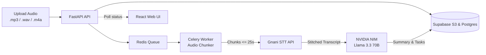

# 🎙️ Gnani Audio Notes

Turn voice memos, meetings, and long audio recordings into clean transcripts, concise summaries, and prioritized action items.

[](https://frontend-azure-beta-45.vercel.app/)
[](https://fastapi.tiangolo.com/)
[](https://react.dev/)
[](https://docs.celeryq.dev/)

---

## What is this?

A lot of speech-to-text APIs struggle with long audio files. Specifically, Gnani's Vachana STT API throws a `MAX_AUDIO_DURATION_EXCEEDED` error when files exceed ~30 seconds.

**Gnani Audio Notes** fixes this by handling the dirty work:
1. It inspects your audio file (`.mp3`, `.wav`, `.m4a` up to 100MB).
2. If it's longer than 25 seconds, it automatically slices the audio into 25-second chunks with a 2-second overlap so no words get cut off mid-sentence.
3. It pushes jobs to a background queue, transcribes each slice via Gnani STT, and stitches the text back together cleanly.
4. Once transcribed, it passes the full text to **Meta Llama 3.3 70B** (via NVIDIA NIM) to extract an executive summary, main talking points, and actionable next steps.
5. Everything updates live on the frontend so you can watch progress step-by-step or listen back to the audio.

---

## Screenshots

### 1. Upload & Workspace
Drop an audio file, see file size and duration details immediately, and view your past notes.

<div align="center">
  
</div>

<br/>

### 2. Live Progress & Audio Player
Watch the 5-step pipeline update from **Uploading → Queued → Transcribing → Summarizing → Completed**, with built-in audio playback.

<div align="center">
  
</div>

<br/>

### 3. Summary & Action Items
Review the generated notes broken down into a quick summary, key discussion points, and next actions.

<div align="center">
  
</div>

---

## How It Works



### The 25-Second Chunking Trick
Gnani's STT works best with short audio snippets. When you upload a file longer than 25 seconds:
- The chunking service slices it into 25-second audio segments with a 2-second overlap.
- Each segment is sent to Gnani's API.
- The returned segments are combined into a single continuous transcript before being passed to the LLM.
- If an individual slice or request fails, the worker retries with exponential backoff rather than dropping the whole job.

---

## Tech Stack

- **Frontend**: React 19, TypeScript, Vite, Lucide icons, vanilla CSS (no bloated UI libraries).
- **Backend API**: FastAPI, Pydantic v2, SlowAPI (rate limiting).
- **Background Jobs**: Celery, Redis.
- **Audio Processing**: PyDub, Mutagen, FFmpeg.
- **Database & Storage**: PostgreSQL (Supabase) via SQLAlchemy & Alembic, Supabase S3 storage (with automatic fallback to local disk if S3 is unavailable).
- **AI & Speech Models**: Gnani Vachana STT v3 + Meta Llama 3.3 70B Instruct (NVIDIA NIM).

---

## Project Structure

```text
Gnani-audio/
├── backend/
│   ├── app/
│   │   ├── alembic/              # Database migrations
│   │   ├── core/                 # Config & rate limiting
│   │   ├── db/                   # Database connection & models
│   │   ├── models/               # AudioNote & ProcessingJob schemas
│   │   ├── queues/               # Job queue dispatcher
│   │   ├── routers/              # API routes (/api/notes, /api/health)
│   │   ├── services/             # Audio chunker, Gnani STT, LLM & storage logic
│   │   ├── workers/              # Celery tasks (transcribe & summarize)
│   │   └── main.py               # FastAPI entrypoint & in-process worker
│   ├── requirements.txt
│   ├── Procfile
│   └── nixpacks.toml             # Installs FFmpeg for cloud deployments
├── frontend/
│   ├── src/
│   │   ├── api/                  # API client
│   │   ├── components/           # Dropzone, Stepper, Audio Player, Note Card
│   │   ├── pages/                # Workspace & Note Detail pages
│   │   └── types/                # TypeScript types
│   ├── package.json
│   └── vite.config.ts
└── docs/
    └── screenshots/
```

---

## Local Setup

### What You'll Need
1. **Python 3.11+**
2. **Node.js 18+**
3. **FFmpeg** (make sure `ffmpeg` is accessible in your terminal)
4. **Redis** (running locally or a free cloud instance like Upstash)

---

### 1. Clone the repo
```bash
git clone https://github.com/Princ3mish/Gnani-audio.git
cd Gnani-audio
```

### 2. Backend setup
```bash
cd backend

# Create & activate a virtual environment
python -m venv .venv

# On Windows:
.\.venv\Scripts\activate
# On macOS / Linux:
source .venv/bin/activate

# Install requirements
pip install -r requirements.txt

# Create your .env file
cp .env.example .env
```

Fill in your `.env` (see below for the variables needed).

#### Run database migrations:
```bash
python -m alembic -c app/alembic.ini upgrade head
```

#### Run the server:
You can run everything in one terminal during development. The FastAPI app automatically starts an in-process Celery worker thread:
```bash
uvicorn app.main:app --reload --port 8000
```

*(Optional)* If you prefer running the worker separately like in production:
```bash
# Terminal 1:
uvicorn app.main:app --reload --port 8000

# Terminal 2:
celery -A app.celery_app worker --loglevel=info
```

### 3. Frontend setup
```bash
cd ../frontend
npm install
npm run dev
```

Open [http://localhost:5173](http://localhost:5173) and you're good to go.

---

## Environment Variables

Put these in `backend/.env`:

```env
# Database (Postgres / Supabase)
DATABASE_URL=postgresql://postgres:<password>@aws-0-ap-northeast-1.pooler.supabase.com:5432/postgres

# Redis
REDIS_URL=rediss://default:<password>@<host>:6379/0

# Object Storage (Supabase S3)
STORAGE_ENDPOINT=https://<project-ref>.storage.supabase.co/storage/v1/s3
STORAGE_ACCESS_KEY=<your-access-key>
STORAGE_SECRET_KEY=<your-secret-key>
STORAGE_BUCKET=audio-notes

# Gnani STT
GNANI_API_KEY=<your-gnani-api-key>
GNANI_BASE_URL=https://api.vachana.ai

# NVIDIA NIM (Llama 3.3 70B)
LLM_API_KEY=<your-nvidia-api-key>
LLM_MODEL=meta/llama-3.3-70b-instruct
LLM_BASE_URL=https://integrate.api.nvidia.com/v1

# Frontend URL (for CORS)
FRONTEND_URL=http://localhost:5173,https://frontend-azure-beta-45.vercel.app
```

In `frontend/.env` (optional, defaults to `http://localhost:8000` in dev):
```env
VITE_API_BASE_URL=http://localhost:8000
```

---

## API Endpoints

All endpoints are prefixed with `/api`:

| Method | Endpoint | What it does |
|---|---|---|
| `POST` | `/notes` | Uploads audio (`multipart/form-data`) and queues transcription |
| `GET` | `/notes` | Returns list of all notes with status and timestamps |
| `GET` | `/notes/{id}` | Gets note details, full transcript, and structured summary |
| `GET` | `/notes/{id}/audio` | Generates a presigned URL to stream the audio |
| `POST` | `/notes/{id}/retry` | Retries transcription if something failed |
| `POST` | `/notes/{id}/retry-summary` | Re-runs just the LLM summary step without re-transcribing |
| `GET` | `/health` | Health check for database, worker thread, and CORS config |

---

## Deployment Notes

### Frontend (Vercel)
- Connect repo, select `frontend` as root directory, preset `Vite`.
- Add environment variable `VITE_API_BASE_URL` pointing to your deployed backend URL.

### Backend (Render Free Tier)
Render's free tier only gives you one free web service, which normally makes running Celery alongside FastAPI difficult. 

To solve this without paying for an extra worker dyno, the backend runs Celery in an in-process daemon thread (`--pool=solo`) inside the FastAPI lifespan. It handles tasks directly in the background without needing a second service.

1. Create a Web Service on Render with root directory `backend`.
2. Build command: `pip install -r requirements.txt`.
3. Start command: `uvicorn app.main:app --host 0.0.0.0 --port $PORT`.
4. Add your environment variables from `.env`.

---

## License

MIT © [Princ3mish](https://github.com/Princ3mish)
